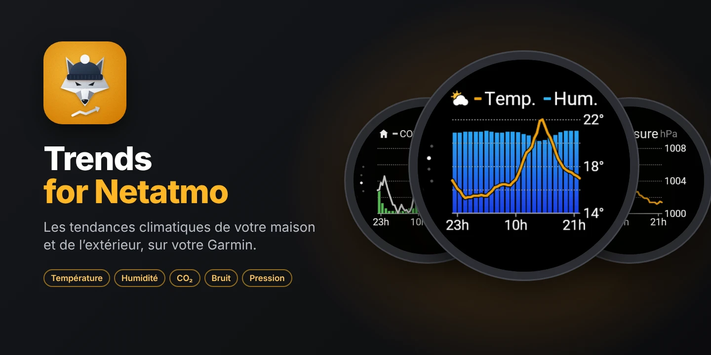
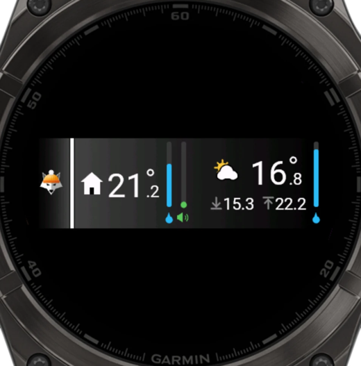
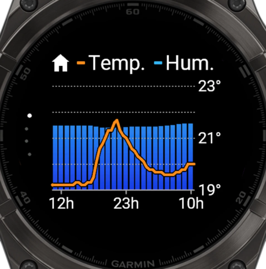
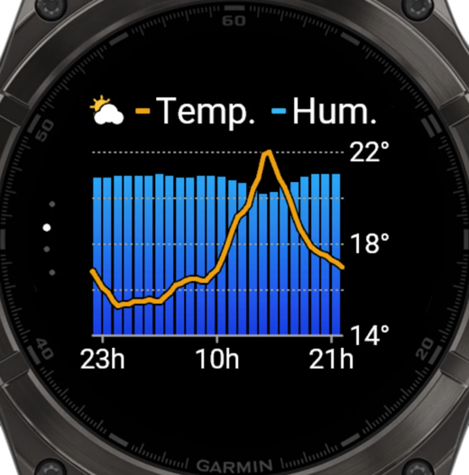
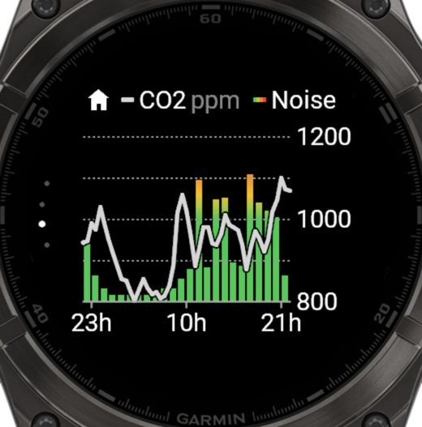
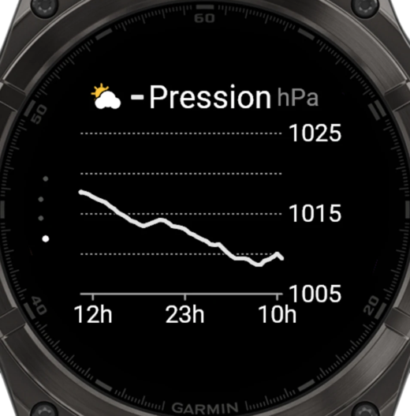

<p align="center"></p>

<h1 align="center">Trends for Netatmo</h1>

<p align="center"><a href="https://apps.garmin.com/apps/9cda70a7-ebe9-4638-a621-8eb39ff1e7c3"><b>▶ Installer depuis le Connect IQ Store</b></a></p>

<p align="center"><a href="README.md">English</a> · <b>Français</b></p>

Les mesures d'une station météo **Netatmo** sur une montre Garmin : un aperçu lisible en une
seconde dans la liste des glances, et quatre écrans « Tendance 24 h ».
La montre interroge directement l'API officielle Netatmo : **aucun serveur** à installer.
App en **anglais, français et allemand** (selon la langue de la montre), compatible avec **57 montres**.

| Aperçu (glance) | 1 · Intérieur | 2 · Extérieur | 3 · CO2 et bruit | 4 · Pression |
|:---:|:---:|:---:|:---:|:---:|
|  |  |  |  |  |
| Maison à gauche, extérieur à droite | Température et humidité | Température et humidité | CO2 et bruit coloré | Pression |

*Captures du simulateur Connect IQ, fēnix 8 47 mm, avec de vraies données.*

Le projet contient deux briques :

| Fichier / dossier | Rôle |
|---|---|
| [`netatmo_explore.py`](netatmo_explore.py) | Script (Mac/Linux) : connexion à Netatmo et affichage de tout ce que renvoie l'API. Sert à vérifier l'accès et de référence pour l'API. |
| [`garmin/`](garmin/) | App **Connect IQ** (Monkey C) pour la montre. |
| [`docs/store/`](docs/store/) | Fiche du Connect IQ Store, politique de confidentialité, logo, captures. |

---

## Sommaire

1. [Fonctionnement](#fonctionnement)
2. [Secrets et sécurité](#secrets-et-sécurité)
3. [Créer l'app Netatmo](#1-créer-lapp-netatmo)
4. [Script Python](#2-script-python-facultatif)
5. [Compiler et installer l'app montre](#3-compiler-et-installer-lapp-montre)
6. [Publier sur le Connect IQ Store](#4-publier-sur-le-connect-iq-store)
7. [Dépannage](#dépannage)
8. [Détails techniques](#détails-techniques)

---

## Fonctionnement

### Architecture

```
 Montre Garmin ──Bluetooth──▶ Garmin Connect ──HTTPS──▶ api.netatmo.com
 (app Connect IQ)              (téléphone)              (API officielle Netatmo Weather)
```

- La montre n'accède pas directement à Internet : ses requêtes passent par l'app
  **Garmin Connect** du téléphone, qui doit être à portée Bluetooth.
- **Pas de serveur intermédiaire** : l'API Netatmo est documentée et maintenue, la montre
  l'appelle directement.
- **Connexion** : l'app embarque le `client_id` / `client_secret` de l'app Netatmo du projet.
  Au premier lancement, elle ouvre la page de consentement Netatmo sur le téléphone
  (notification Garmin Connect) : chaque utilisateur y connecte **son** compte et obtient ses
  propres jetons. La montre les renouvelle seule ; Netatmo change le *refresh token* à chaque
  renouvellement, l'app enregistre toujours le dernier reçu.
- **Aperçu** : mis à jour en tâche de fond toutes les 10 min (rythme d'envoi des stations),
  même widget fermé.
- **Écrans** : l'historique des 24 dernières heures (une mesure toutes les 30 min) est chargé
  **une seule fois à l'ouverture**, et pas du tout s'il a moins de 10 min. Changer d'écran ne
  fait que redessiner.
- **Mode démo** : réglage de l'app dans Garmin Connect ; affiche des données d'exemple, sans
  compte Netatmo (utile pour l'essayer, et pour la validation du Store).

### Aperçu (glance)

- **À gauche, la maison** : symbole maison, température intérieure, jauge d'humidité
  (goutte bleue dessous) et jauge du niveau sonore (haut-parleur dessous). La jauge du bruit
  suit l'échelle colorée vert → jaune → orange → rouge (30 à 80 dB) ; le haut-parleur reste vert.
- **À droite, l'extérieur** : symbole soleil et nuage et température extérieure avec chevron de
  tendance sur une ligne, minimum ↓ et maximum ↑ du jour dessous (sur toute la largeur, sous le
  symbole), jauge d'humidité (goutte bleue).

Les valeurs passent en gris si la dernière mesure date de plus de 2 h.

### Écrans « Tendance 24 h »

Sur le modèle de l'écran *Tendance* de la météo Garmin : en haut, le symbole (maison ou
extérieur) et la légende sur une ligne ; barres par heure en dégradé, courbe par demi-heure
graduée à droite (extrêmes et milieu), repères horaires en bas (début + 1 h, milieu, fin − 1 h).
Les 4 écrans glissent de l'un à l'autre ; 4 petits points, à gauche en arc le long du bord,
indiquent l'écran affiché. L'**ambre** du logo (`#F0A014`) colore les courbes de température
et de pression : c'est la couleur de l'app.

| Écran | Symbole | Courbe | Barres |
|---|---|---|---|
| 1 | maison | température intérieure (ambre) | humidité intérieure (0–100 %) |
| 2 | soleil et nuage | température extérieure (ambre) | humidité extérieure (0–100 %) |
| 3 | maison | CO2 en ppm (gris) | bruit, de vert (calme) à rouge (80 dB) |
| 4 | soleil et nuage | pression en hPa (ambre) | — |

| Geste | Action |
|---|---|
| DOWN / balayage vers le haut | écran suivant |
| UP / balayage vers le bas | écran précédent |
| START / toucher | écran suivant |
| UP maintenu (menu) | actualiser |
| BACK | quitter |

Après l'écran 4, on revient à l'écran 1.

### Montres compatibles

Les 57 modèles Connect IQ 5+ à écran couleur **avec polices vectorielles** (nécessaires à la
mise en page de l'aperçu) — liste exacte dans [`garmin/manifest.xml`](garmin/manifest.xml) :

- **fēnix** 7 / 7S / 7X (et Pro, Solar), 8 (AMOLED, Pro, Solar), 9 (toutes versions), fēnix E,
  **epix** (Gen 2) et epix Pro, **Enduro** 3 et 4, **tactix** 7 / 8, **quatix** 7 / 8 ;
- **Forerunner** 165, 170, 265, 570, 955, 965, 970, Forerunner 70 ;
- **Venu** 3 / 3S, Venu 4, Venu X1, **vívoactive** 6 ;
- **MARQ** (Gen 2) et (Gen 3), **D2** Mach 1 / Mach 2, **Descent** Mk3, **Approach** S70 / S72.

Non prises en charge : montres sans polices vectorielles (Venu 2, Venu Sq 2, Forerunner 255,
vívoactive 5…), écrans monochromes (Instinct), modèles Connect IQ 3/4.

---

## Secrets et sécurité

Aucun secret n'est versionné : les fichiers concernés sont listés dans [`.gitignore`](.gitignore).

| Secret | Où il vit | Versionné ? |
|---|---|---|
| `client_id` / `client_secret` Netatmo (script) | `netatmo_config.json` (droits 600) | Non |
| `client_id` / `client_secret` Netatmo (app) | `garmin/source-secrets/Secrets.mc` (compilé dans l'app) | Non |
| Jetons du script | `netatmo_tokens.json` (droits 600) | Non |
| Jetons de la montre | stockage privé de l'app sur la montre | — |
| Clé de signature Connect IQ | `garmin/developer_key.der` | Non |
| Binaires de l'app | `garmin/bin/` (`.prg`, `.iq`) | Non |
| Réponses brutes de l'API | `netatmo_output/` | Non |

- Le `client_id` / `client_secret` identifient **l'app**, pas un utilisateur : chaque
  utilisateur donne son accord sur les pages Netatmo et n'accède qu'à ses propres données.
  Le secret est compilé dans le binaire ; s'il était détourné, le régénérer sur
  dev.netatmo.com et publier une mise à jour.
- Le script et la montre ont chacun leur propre connexion Netatmo : utiliser l'un ne
  déconnecte pas l'autre.
- **Sauvegarder `garmin/developer_key.der`** hors du dépôt : sans cette clé, impossible de
  publier une mise à jour de l'app sur le Store (ni de remplacer l'app installée).

---

## 1. Créer l'app Netatmo

Sur https://dev.netatmo.com/apps → **Create** :

- nom et description de l'app ;
- **Redirect URI** : `http://localhost:8765/callback` (le même pour le script et la montre ;
  Garmin Connect intercepte cette adresse, rien n'a besoin d'y répondre).

Noter le `client_id` et le `client_secret`.

---

## 2. Script Python (facultatif)

Python 3.8+, sans dépendance.

```bash
python3 netatmo_explore.py
```

Au premier lancement, le script demande le `client_id` et le `client_secret` (enregistrés
dans `netatmo_config.json`), ouvre la connexion Netatmo dans le navigateur, puis affiche un
résumé des mesures et l'historique 24 h de la température extérieure. Les réponses brutes sont
dans `netatmo_output/`.

| Option | Effet |
|---|---|
| `--login` | forcer une nouvelle connexion |
| `--raw` | afficher aussi le JSON brut |

---

## 3. Compiler et installer l'app montre

### a. Prérequis (une fois)

1. **Java** : JDK *Temurin 17* ou plus récent (https://adoptium.net).
2. **SDK Connect IQ** : *SDK Manager* (https://developer.garmin.com/connect-iq/sdk/),
   dernière version en **current SDK**, et les modèles de montre voulus.

### b. Renseigner le client_id et le client_secret

`build.sh` crée `garmin/source-secrets/Secrets.mc` au premier lancement :

- depuis `netatmo_config.json` si le script a déjà été utilisé ;
- sinon depuis [`Secrets.example.mc`](garmin/Secrets.example.mc), à compléter.

### c. Compiler

```bash
cd garmin
./build.sh fenix847mm          # → bin/TrendsForNetatmo.prg
./build.sh sim fenix847mm      # compile et lance le simulateur
```

Au premier lancement, `build.sh` génère aussi la clé de signature `developer_key.der`.

Version finale pour une montre précise (dans `garmin/bin/montres/`) :

```bash
cd garmin
SDK="$(cat ~/Library/Application\ Support/Garmin/ConnectIQ/current-sdk.cfg)"
"${SDK%/}/bin/monkeyc" -f monkey.jungle -d fenix847mm -y developer_key.der \
  -o bin/montres/TrendsForNetatmo-fenix847mm.prg -r -w
```

L'icône de l'app est fournie à la taille exacte de chaque montre (`resources-icon40` … `70`,
associés aux modèles dans `monkey.jungle`).

### d. Installer sur la montre (hors Store)

1. Quitter **Garmin Express**, brancher la montre en USB. Sur macOS, utiliser **OpenMTP**
   (https://openmtp.ganeshrvel.com).
2. Copier le `.prg` du modèle dans `GARMIN/APPS`.
3. Débrancher : l'app apparaît dans les aperçus (sinon *Réglages › Apparence › Aperçus ›
   Ajouter*).
4. Ouvrir l'app (téléphone à proximité, Garmin Connect ouvert) : toucher la notification
   Garmin Connect et se connecter à Netatmo. À faire une fois par montre.

Les réglages de l'app (mode démo) n'apparaissent dans Garmin Connect que pour une app installée
depuis le Store.

---

## 4. Publier sur le Connect IQ Store

1. Générer le paquet multi-montres :

   ```bash
   cd garmin
   SDK="$(cat ~/Library/Application\ Support/Garmin/ConnectIQ/current-sdk.cfg)"
   "${SDK%/}/bin/monkeyc" -e -f monkey.jungle -y developer_key.der \
     -o bin/store/TrendsForNetatmo.iq -r -w
   ```

2. Première publication sur https://apps.garmin.com/developer : **Upload an app**, déposer
   `bin/store/TrendsForNetatmo.iq`, puis remplir la fiche avec les textes de
   [`docs/store/fiche-store.md`](docs/store/fiche-store.md) (anglais, français et allemand, notes pour
   les testeurs), le logo [`docs/store/icone-store.png`](docs/store/icone-store.png), les images
   hero et les captures [`docs/store/captures/`](docs/store/captures/).
3. Politique de confidentialité : [`docs/store/PRIVACY.md`](docs/store/PRIVACY.md).
4. Mise à jour : sur la [page Store de l'app](https://apps.garmin.com/apps/9cda70a7-ebe9-4638-a621-8eb39ff1e7c3), **Upload New Version** ; même clé de
   signature, numéro de version augmenté, nouveau `.iq`.

---

## Dépannage

| Message sur la montre | Cause probable |
|---|---|
| *Ouvrir pour se connecter* (aperçu) | pas encore connecté : ouvrir l'app |
| *Connexion Netatmo : ouvre la notification…* | la page de connexion attend sur le téléphone |
| *Connexion refusée* | connexion annulée, ou Redirect URI différent de `http://localhost:8765/callback` |
| *App non configurée* | `Secrets.mc` absent ou incomplet : recompiler |
| *Téléphone non connecté* | Bluetooth coupé ou Garmin Connect fermé |
| *Délai dépassé* | réseau lent ; réessayer (UP maintenu) |
| *Netatmo indisponible* | erreur passagère du serveur Netatmo (déjà réessayée une fois) |
| *… · HH:MM* en gris | l'actualisation a échoué : les courbes affichées datent de HH:MM |

Dans le simulateur, les réglages et données de l'app restent d'une compilation à l'autre :
*File › Reset All App Data* pour repartir de zéro. Le mode démo se règle dans
*File › Edit Application Properties*.

---

## Détails techniques

### API Netatmo utilisée

| Étape | Requête |
|---|---|
| Connexion | `https://api.netatmo.com/oauth2/authorize` (scope `read_station`), puis `POST /oauth2/token` (`authorization_code`, puis `refresh_token`) |
| Dernières mesures | `GET /api/getstationsdata` → `body.devices[0]` (module intérieur) et `modules[]` de type `NAModule1` (extérieur) |
| Historique intérieur | `GET /api/getmeasure` `scale=30min`, `type=temperature,humidity,co2,noise,pressure`, `optimize=true` |
| Historique extérieur | `GET /api/getmeasure` avec `module_id`, `type=temperature,humidity` |

Le jeton d'accès est renouvelé automatiquement (et une fois de plus en cas de 401/403) ;
une erreur 5xx ou réseau est réessayée une fois.

### Contraintes de la montre

- **Mémoire** : l'aperçu et la tâche de fond disposent d'environ 64 Ko ; les données partagées
  sont donc stockées sous une forme compacte (`current`, `history`).
- **Temps de calcul** : la montre arrête une app qui calcule trop longtemps d'un coup
  (*watchdog*). Le dégradé des barres est donc calculé une fois par ligne de 3 px, puis
  réutilisé pour toutes les barres.
- **Polices** : les chiffres de l'aperçu utilisent des polices vectorielles
  (`Graphics.getVectorFont`) pour être dimensionnés au pixel près ; d'où la limitation aux
  montres qui en disposent.
- **Indicateur de page** : la boucle de vues native (`ViewLoop`) impose un grand arc ; l'app
  enchaîne donc ses vues avec `switchToView` (`SLIDE_UP` / `SLIDE_DOWN`) et dessine ses propres
  points (en colonne sur les écrans rectangulaires).
- **Fluidité du glissement** : la montre doit avoir dessiné le nouvel écran avant de lancer
  l'animation. Chaque écran est donc dessiné une seule fois dans une image en mémoire graphique
  (`Graphics.createBufferedBitmap`), puis simplement recopié ; les écrans voisins sont préparés
  juste après l'affichage. Au retour après une notification, qui peut réutiliser cette mémoire,
  l'écran est redessiné entièrement. 3 images sont réutilisées (affiché + voisins) plutôt que
  libérées et recréées, ce qui pouvait en effacer le contenu.
- **Langues** : textes dans `resources/strings` (anglais, par défaut) et
  `resources-fre/strings` (français) et `resources-deu/strings` (allemand).

### Structure de l'app Connect IQ

| Fichier | Rôle |
|---|---|
| `source/NetatmoApp.mc` | point d'entrée, vue complète, aperçu, tâche de fond, réglages |
| `source/NetatmoGlanceView.mc` | aperçu (maison à gauche, extérieur à droite) |
| `source/MainView.mc` | `NetatmoStore` (chargement, connexion), `PageView` (un écran « Tendance »), messages |
| `source/Pages.mc` | navigation entre les 4 écrans |
| `source/Netatmo.mc` | accès à l'API, jetons, conversion des réponses |
| `source/NetatmoService.mc` | tâche de fond (dernières mesures pour l'aperçu) |
| `source/Draw.mc` | symboles, jauges, couleurs, polices |
| `source/Demo.mc` | données d'exemple (mode démo) |
| `source-secrets/Secrets.mc` | identifiants de l'app Netatmo (non versionné) |

### Arborescence

```
.
├── README.md                    # anglais
├── README.fr.md                 # français
├── docs/                        # captures du README
│   └── store/                   # fiche Store, confidentialité, logo, captures Store
├── netatmo_explore.py           # script d'exploration de l'API
└── garmin/
    ├── manifest.xml             # 57 modèles cibles, permissions, langues
    ├── monkey.jungle            # sources, icône par modèle
    ├── build.sh                 # compilation / simulateur
    ├── Secrets.example.mc       # modèle des identifiants (à copier)
    ├── resources/               # icône, chaînes (anglais), réglage « Mode démo »
    ├── resources-fre/           # chaînes en français
    ├── resources-deu/           # chaînes en allemand
    ├── resources-icon40 … 70/   # icône à la taille de chaque montre
    └── source/                  # code Monkey C
```
