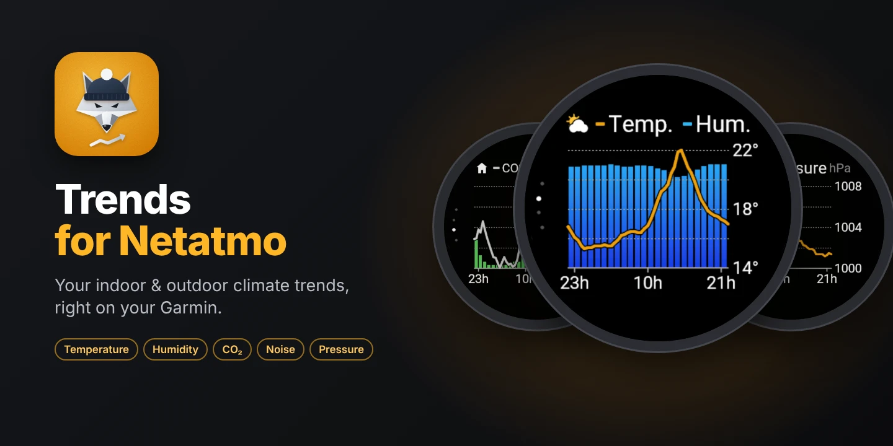
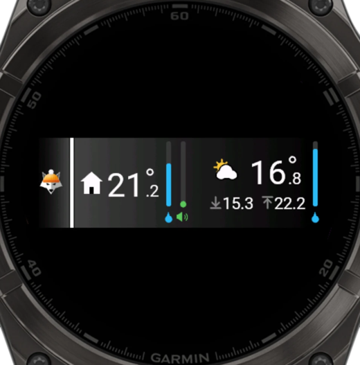
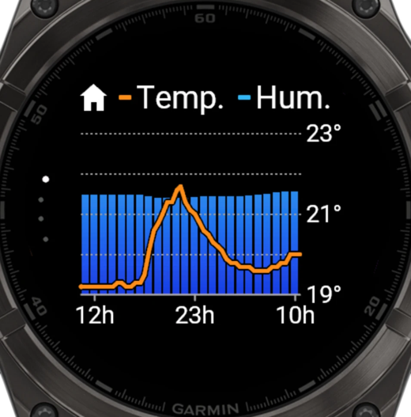
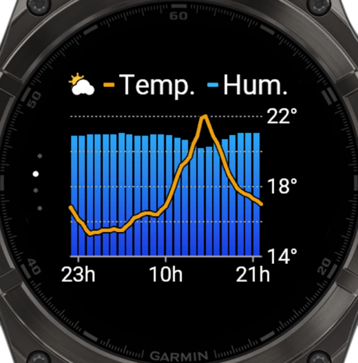
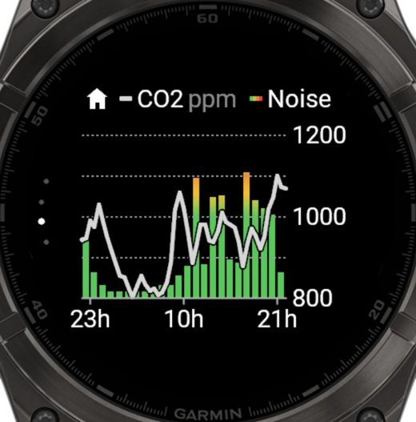
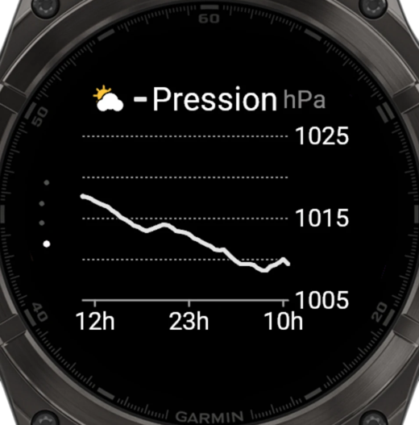

<p align="center"></p>

<h1 align="center">Trends for Netatmo</h1>

<p align="center"><a href="https://apps.garmin.com/apps/9cda70a7-ebe9-4638-a621-8eb39ff1e7c3"><b>▶ Get it on the Connect IQ Store</b></a></p>

<p align="center"><b>English</b> · <a href="README.fr.md">Français</a></p>

Your **Netatmo** weather station on a Garmin watch: a glance you can read in one second, and
four "24-hour trend" screens.
The watch calls the official Netatmo API directly: **no server** to run.
The app is in **English and French** (following the watch language) and supports **57 watches**.

| Glance | 1 · Indoor | 2 · Outdoor | 3 · CO2 and noise | 4 · Pressure |
|:---:|:---:|:---:|:---:|:---:|
|  |  |  |  |  |
| Home on the left, outdoor on the right | Temperature and humidity | Temperature and humidity | CO2 and colour-coded noise | Pressure |

*Connect IQ simulator screenshots, fēnix 8 47 mm, with real data.*

The project has two parts:

| File / folder | Purpose |
|---|---|
| [`netatmo_explore.py`](netatmo_explore.py) | Script (Mac/Linux): signs in to Netatmo and prints everything the API returns. Useful to check access and as an API reference. |
| [`garmin/`](garmin/) | **Connect IQ** app (Monkey C) for the watch. |
| [`docs/store/`](docs/store/) | Connect IQ Store listing, privacy policy, logo, screenshots. |

---

## Contents

1. [How it works](#how-it-works)
2. [Secrets and security](#secrets-and-security)
3. [Create the Netatmo app](#1-create-the-netatmo-app)
4. [Python script](#2-python-script-optional)
5. [Build and install the watch app](#3-build-and-install-the-watch-app)
6. [Publish on the Connect IQ Store](#4-publish-on-the-connect-iq-store)
7. [Troubleshooting](#troubleshooting)
8. [Technical details](#technical-details)

---

## How it works

### Architecture

```
 Garmin watch ──Bluetooth──▶ Garmin Connect ──HTTPS──▶ api.netatmo.com
 (Connect IQ app)             (phone)                  (official Netatmo Weather API)
```

- The watch has no direct Internet access: its requests go through the **Garmin Connect**
  app on the phone, which must be within Bluetooth range.
- **No intermediate server**: the Netatmo API is documented and maintained, and the watch
  calls it directly.
- **Sign-in**: the app embeds the `client_id` / `client_secret` of the project's Netatmo app.
  On first launch it opens the Netatmo consent page on the phone (Garmin Connect
  notification): each user signs in with **their own** account and gets their own tokens.
  The watch renews them on its own; Netatmo issues a new *refresh token* on every renewal,
  and the app always stores the latest one.
- **Glance**: refreshed in the background every 10 min (the stations' upload rate), even when
  the widget is closed.
- **Screens**: the last 24 hours of history (one measurement every 30 min) are loaded
  **once, when the app opens**, and not at all if they are less than 10 min old. Switching
  screens only redraws.
- **Demo mode**: an app setting in Garmin Connect; shows sample data without a Netatmo account
  (handy to try the app, and for Store review).

### Glance

- **Left, home**: house symbol, indoor temperature, humidity gauge (blue drop below) and noise
  gauge (speaker below). The noise gauge follows a green → yellow → orange → red scale
  (30 to 80 dB); the speaker stays green.
- **Right, outdoor**: sun-and-cloud symbol and outdoor temperature with a trend chevron on one
  line, today's minimum ↓ and maximum ↑ below (full width, under the symbol), humidity gauge
  (blue drop).

Values turn grey when the latest measurement is more than 2 h old.

### "24-hour trend" screens

Modelled on the *Trend* screen of the Garmin weather app: the symbol (home or outdoor) and the
legend on one line at the top; hourly bars with a gradient, a half-hourly curve with a scale on
the right (extremes and middle), time marks at the bottom (start + 1 h, middle, end − 1 h).
The 4 screens slide into one another; 4 small dots on the left, in an arc along the edge, show
the current screen. The logo's **amber** (`#F0A014`) colours the temperature and pressure
curves: it is the app's signature colour.

| Screen | Symbol | Curve | Bars |
|---|---|---|---|
| 1 | home | indoor temperature (amber) | indoor humidity (0–100 %) |
| 2 | sun and cloud | outdoor temperature (amber) | outdoor humidity (0–100 %) |
| 3 | home | CO2 in ppm (grey) | noise, from green (quiet) to red (80 dB) |
| 4 | sun and cloud | pressure in hPa (amber) | — |

| Gesture | Action |
|---|---|
| DOWN / swipe up | next screen |
| UP / swipe down | previous screen |
| START / tap | next screen |
| hold UP (menu) | refresh |
| BACK | exit |

After screen 4, it wraps back to screen 1.

### Compatible watches

The 57 Connect IQ 5+ colour models **with vector fonts** (needed for the glance layout); the
exact list is in [`garmin/manifest.xml`](garmin/manifest.xml):

- **fēnix** 7 / 7S / 7X (and Pro, Solar), 8 (AMOLED, Pro, Solar), 9 (all versions), fēnix E,
  **epix** (Gen 2) and epix Pro, **Enduro** 3 and 4, **tactix** 7 / 8, **quatix** 7 / 8;
- **Forerunner** 165, 170, 265, 570, 955, 965, 970, Forerunner 70;
- **Venu** 3 / 3S, Venu 4, Venu X1, **vívoactive** 6;
- **MARQ** (Gen 2) and (Gen 3), **D2** Mach 1 / Mach 2, **Descent** Mk3, **Approach** S70 / S72.

Not supported: watches without vector fonts (Venu 2, Venu Sq 2, Forerunner 255,
vívoactive 5…), monochrome screens (Instinct), Connect IQ 3/4 models.

---

## Secrets and security

No secret is committed: the files involved are listed in [`.gitignore`](.gitignore).

| Secret | Where it lives | Committed? |
|---|---|---|
| Netatmo `client_id` / `client_secret` (script) | `netatmo_config.json` (mode 600) | No |
| Netatmo `client_id` / `client_secret` (app) | `garmin/source-secrets/Secrets.mc` (compiled into the app) | No |
| Script tokens | `netatmo_tokens.json` (mode 600) | No |
| Watch tokens | the app's private storage on the watch | — |
| Connect IQ signing key | `garmin/developer_key.der` | No |
| App binaries | `garmin/bin/` (`.prg`, `.iq`) | No |
| Raw API responses | `netatmo_output/` | No |

- The `client_id` / `client_secret` identify **the app**, not a user: each user grants
  consent on Netatmo's pages and only ever accesses their own data. The secret is compiled
  into the binary; if it were ever misused, regenerate it on dev.netatmo.com and publish an
  update.
- The script and the watch each have their own Netatmo session: using one does not sign the
  other out.
- **Back up `garmin/developer_key.der`** outside the repository: without this key you cannot
  publish an update of the app on the Store (nor replace the installed app).

---

## 1. Create the Netatmo app

On https://dev.netatmo.com/apps → **Create**:

- app name and description;
- **Redirect URI**: `http://localhost:8765/callback` (the same for the script and the watch;
  Garmin Connect intercepts this address, nothing needs to answer on it).

Write down the `client_id` and the `client_secret`.

---

## 2. Python script (optional)

Python 3.8+, no dependencies.

```bash
python3 netatmo_explore.py
```

On first launch, the script asks for the `client_id` and `client_secret` (saved in
`netatmo_config.json`), opens the Netatmo sign-in page in the browser, then prints a summary of
the measurements and the 24-hour outdoor temperature history. Raw responses are saved in
`netatmo_output/`.

| Option | Effect |
|---|---|
| `--login` | force a new sign-in |
| `--raw` | also print the raw JSON |

---

## 3. Build and install the watch app

### a. Prerequisites (once)

1. **Java**: JDK *Temurin 17* or later (https://adoptium.net).
2. **Connect IQ SDK**: *SDK Manager* (https://developer.garmin.com/connect-iq/sdk/), latest
   version set as **current SDK**, plus the watch models you need.

### b. Provide the client_id and client_secret

`build.sh` creates `garmin/source-secrets/Secrets.mc` on first run:

- from `netatmo_config.json` if the script has already been used;
- otherwise from [`Secrets.example.mc`](garmin/Secrets.example.mc), to be filled in.

### c. Build

```bash
cd garmin
./build.sh fenix847mm          # → bin/TrendsForNetatmo.prg
./build.sh sim fenix847mm      # build and launch the simulator
```

On first run, `build.sh` also generates the signing key `developer_key.der`.

Release build for a given watch (in `garmin/bin/montres/`):

```bash
cd garmin
SDK="$(cat ~/Library/Application\ Support/Garmin/ConnectIQ/current-sdk.cfg)"
"${SDK%/}/bin/monkeyc" -f monkey.jungle -d fenix847mm -y developer_key.der \
  -o bin/montres/TrendsForNetatmo-fenix847mm.prg -r -w
```

The app icon is provided at the exact size of each watch (`resources-icon40` … `70`, mapped to
the models in `monkey.jungle`).

### d. Install on the watch (outside the Store)

1. Quit **Garmin Express** and plug the watch in over USB. On macOS, use **OpenMTP**
   (https://openmtp.ganeshrvel.com).
2. Copy the model's `.prg` into `GARMIN/APPS`.
3. Unplug: the app shows up in the glances (otherwise *Settings › Appearance › Glances ›
   Add*).
4. Open the app (phone nearby, Garmin Connect open): tap the Garmin Connect notification and
   sign in to Netatmo. Needed once per watch.

App settings (Demo mode) only show up in Garmin Connect for apps installed from the Store.

---

## 4. Publish on the Connect IQ Store

1. Build the multi-device package:

   ```bash
   cd garmin
   SDK="$(cat ~/Library/Application\ Support/Garmin/ConnectIQ/current-sdk.cfg)"
   "${SDK%/}/bin/monkeyc" -e -f monkey.jungle -y developer_key.der \
     -o bin/store/TrendsForNetatmo.iq -r -w
   ```

2. First release on https://apps.garmin.com/developer: **Upload an app**, attach
   `bin/store/TrendsForNetatmo.iq`, then fill in the listing with the texts from
   [`docs/store/fiche-store.md`](docs/store/fiche-store.md) (English and French, reviewer
   notes), the logo [`docs/store/icone-store.png`](docs/store/icone-store.png), the hero images
   and the screenshots in [`docs/store/captures/`](docs/store/captures/).
3. Privacy policy: [`docs/store/PRIVACY.md`](docs/store/PRIVACY.md).
4. Updates: on the [app's Store page](https://apps.garmin.com/apps/9cda70a7-ebe9-4638-a621-8eb39ff1e7c3),
   **Upload New Version**; same signing key, higher version number, new `.iq`.

---

## Troubleshooting

| Message on the watch | Likely cause |
|---|---|
| *Open to sign in* (glance) | not signed in yet: open the app |
| *Netatmo sign-in: open the notification…* | the sign-in page is waiting on the phone |
| *Sign-in refused* | sign-in cancelled, or Redirect URI other than `http://localhost:8765/callback` |
| *App not configured* | `Secrets.mc` missing or incomplete: rebuild |
| *Phone not connected* | Bluetooth off or Garmin Connect closed |
| *Timed out* | slow network; try again (hold UP) |
| *Netatmo unavailable* | temporary Netatmo server error (already retried once) |
| *… · HH:MM* in grey | the refresh failed: the curves shown date from HH:MM |

In the simulator, app settings and data persist across builds: *File › Reset All App Data*
starts from scratch. Demo mode is set in *File › Edit Application Properties*.

---

## Technical details

### Netatmo API used

| Step | Request |
|---|---|
| Sign-in | `https://api.netatmo.com/oauth2/authorize` (scope `read_station`), then `POST /oauth2/token` (`authorization_code`, then `refresh_token`) |
| Latest measurements | `GET /api/getstationsdata` → `body.devices[0]` (indoor module) and `modules[]` of type `NAModule1` (outdoor) |
| Indoor history | `GET /api/getmeasure` `scale=30min`, `type=temperature,humidity,co2,noise,pressure`, `optimize=true` |
| Outdoor history | `GET /api/getmeasure` with `module_id`, `type=temperature,humidity` |

The access token is renewed automatically (and once more on a 401/403); a 5xx or network
error is retried once.

### Watch constraints

- **Memory**: the glance and the background task get about 64 KB, so shared data is stored in
  a compact form (`current`, `history`).
- **Compute time**: the watch kills an app that computes for too long in one go (*watchdog*).
  The bar gradient is therefore computed once per 3 px row, then reused for every bar.
- **Fonts**: the glance digits use vector fonts (`Graphics.getVectorFont`) to be sized to the
  pixel; hence the restriction to watches that have them.
- **Page indicator**: the native view loop (`ViewLoop`) imposes a large arc, so the app chains
  its views with `switchToView` (`SLIDE_UP` / `SLIDE_DOWN`) and draws its own dots (a column on
  rectangular screens).
- **Smooth sliding**: the watch must have drawn the new screen before it starts the animation.
  Each screen is therefore drawn once into an image in graphics memory
  (`Graphics.createBufferedBitmap`) and then simply copied; neighbouring screens are prepared
  right after display. When returning from a notification, which may reuse that memory, the
  screen is fully redrawn. 3 images are reused (current + neighbours) rather than freed and
  recreated, which could wipe their content.
- **Languages**: strings in `resources/strings` (English, default) and `resources-fre/strings`
  (French).

### Connect IQ app structure

| File | Role |
|---|---|
| `source/NetatmoApp.mc` | entry point, full view, glance, background task, settings |
| `source/NetatmoGlanceView.mc` | glance (home on the left, outdoor on the right) |
| `source/MainView.mc` | `NetatmoStore` (loading, sign-in), `PageView` (one "trend" screen), messages |
| `source/Pages.mc` | navigation between the 4 screens |
| `source/Netatmo.mc` | API access, tokens, response parsing |
| `source/NetatmoService.mc` | background task (latest measurements for the glance) |
| `source/Draw.mc` | symbols, gauges, colours, fonts |
| `source/Demo.mc` | sample data (demo mode) |
| `source-secrets/Secrets.mc` | Netatmo app credentials (not committed) |

### Tree

```
.
├── README.md                    # English
├── README.fr.md                 # French
├── docs/                        # README screenshots
│   └── store/                   # Store listing, privacy, logo, Store images
├── netatmo_explore.py           # API exploration script
└── garmin/
    ├── manifest.xml             # 57 target models, permissions, languages
    ├── monkey.jungle            # sources, per-model icon
    ├── build.sh                 # build / simulator
    ├── Secrets.example.mc       # credentials template (to copy)
    ├── resources/               # icon, strings (English), "Demo mode" setting
    ├── resources-fre/           # French strings
    ├── resources-icon40 … 70/   # icon at each watch's size
    └── source/                  # Monkey C code
```
