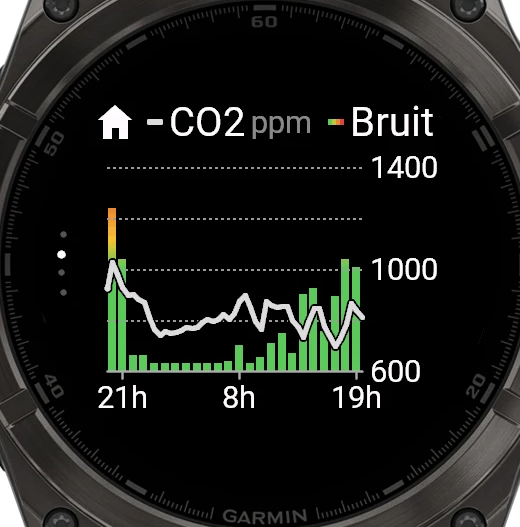
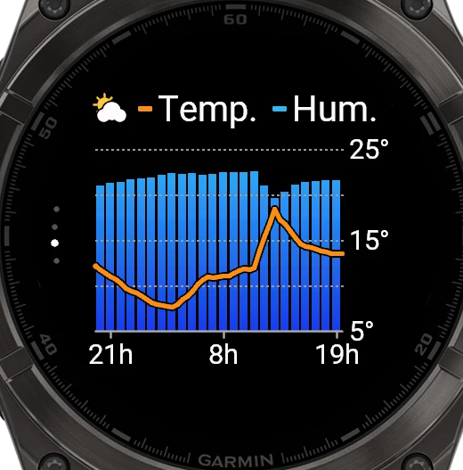

# Météo Netatmo sur montre Garmin

Les mesures d'une station météo **Netatmo** sur une montre Garmin (fēnix 8, Venu 4, epix 2) :
un aperçu dans la liste des glances et quatre écrans « Tendance 24 h ».
La montre interroge directement l'API officielle Netatmo : **aucun serveur** à installer.

| Aperçu (glance) | 1 · Intérieur | 2 · CO2 et bruit | 3 · Extérieur | 4 · Pression |
|:---:|:---:|:---:|:---:|:---:|
|  |  |  |  |  |
| Maison à gauche, extérieur à droite | Température et humidité | CO2 et bruit coloré | Température et humidité | Pression |

*Captures du simulateur Connect IQ, fēnix 8 47 mm, avec de vraies données.*

Le projet contient deux briques :

| Fichier / dossier | Rôle |
|---|---|
| [`netatmo_explore.py`](netatmo_explore.py) | Script (Mac/Linux) : connexion à Netatmo et affichage de tout ce que renvoie l'API. Sert à vérifier l'accès et de référence pour l'API. |
| [`garmin/`](garmin/) | App **Connect IQ** (Monkey C) pour la montre. |

---

## Sommaire

1. [Fonctionnement](#fonctionnement)
2. [Secrets et sécurité](#secrets-et-sécurité)
3. [Créer l'app Netatmo](#1-créer-lapp-netatmo)
4. [Script Python](#2-script-python-facultatif)
5. [Compiler et installer l'app montre](#3-compiler-et-installer-lapp-montre)
6. [Dépannage](#dépannage)
7. [Détails techniques](#détails-techniques)

---

## Fonctionnement

### Architecture

```
 Montre Garmin ──Bluetooth──▶ Garmin Connect ──HTTPS──▶ api.netatmo.com
 (app Connect IQ)              (téléphone)              (API officielle Netatmo Weather)
```

- La montre n'accède pas directement à Internet : ses requêtes passent par l'app
  **Garmin Connect** du téléphone, qui doit être à portée Bluetooth.
- **Pas de serveur intermédiaire** : l'API Netatmo est documentée et maintenue, la montre
  l'appelle directement.
- **Connexion** : au premier lancement, l'app ouvre la page de connexion Netatmo sur le
  téléphone (notification Garmin Connect). Après accord, la montre garde ses jetons et les
  renouvelle seule. Netatmo change le *refresh token* à chaque renouvellement : l'app
  enregistre toujours le dernier reçu.
- **Aperçu** : mis à jour en tâche de fond toutes les 10 min (rythme d'envoi des stations).
- **Écrans** : l'historique des 24 dernières heures (une mesure toutes les 30 min) est chargé
  **une seule fois à l'ouverture**, et pas du tout s'il a moins de 10 min. Changer d'écran ne
  fait que redessiner.

### Aperçu (glance)

- **À gauche, la maison** : symbole maison, température intérieure, jauge d'humidité
  (goutte bleue dessous) et jauge du niveau sonore (haut-parleur dessous). La jauge du bruit
  et son symbole suivent l'échelle colorée vert → jaune → orange → rouge (30 à 80 dB).
- **À droite, l'extérieur** : symbole soleil et nuage, température extérieure avec chevron de
  tendance, minimum ↓ et maximum ↑ du jour dessous, jauge d'humidité (goutte bleue).

Les valeurs passent en gris si la dernière mesure date de plus de 2 h.

### Écrans « Tendance 24 h »

Sur le modèle de l'écran *Tendance* de la météo Garmin : en haut, le symbole (maison ou
extérieur) et la légende sur une ligne ; barres par heure en dégradé, courbe par demi-heure
graduée à droite (extrêmes et milieu), repères horaires en bas (début + 1 h, milieu, fin − 1 h).
Les 4 écrans glissent de l'un à l'autre ; 4 petits points, à gauche le long du bord, indiquent
l'écran affiché.

| Écran | Symbole | Courbe | Barres |
|---|---|---|---|
| 1 | maison | température intérieure (orange) | humidité intérieure (0–100 %) |
| 2 | maison | CO2 en ppm (gris) | bruit, de vert (calme) à rouge (80 dB) |
| 3 | soleil et nuage | température extérieure (orange) | humidité extérieure (0–100 %) |
| 4 | soleil et nuage | pression en hPa (blanc) | — |

| Geste | Action |
|---|---|
| DOWN / balayage vers le haut | écran suivant |
| UP / balayage vers le bas | écran précédent |
| START / toucher | écran suivant |
| UP maintenu (menu) | actualiser |
| BACK | quitter |

Après l'écran 4, on revient à l'écran 1.

### Montres compatibles

| Modèle | Identifiant Connect IQ |
|---|---|
| fēnix 8 AMOLED 43 mm | `fenix843mm` |
| fēnix 8 AMOLED 47 mm | `fenix847mm` |
| fēnix 8 Pro 47 mm | `fenix8pro47mm` |
| fēnix 8 Solar 47 mm | `fenix8solar47mm` |
| fēnix 8 Solar 51 mm | `fenix8solar51mm` |
| Venu 4 41 mm | `venu441mm` |
| Venu 4 45 mm | `venu445mm` |
| epix (Gen 2) | `epix2` |
| epix Pro (Gen 2) 42 / 47 / 51 mm | `epix2pro42mm` / `epix2pro47mm` / `epix2pro51mm` |

---

## Secrets et sécurité

Aucun secret n'est versionné : les fichiers concernés sont listés dans [`.gitignore`](.gitignore).

| Secret | Où il vit | Versionné ? |
|---|---|---|
| `client_id` / `client_secret` Netatmo | `netatmo_config.json` (script, droits 600) | Non |
| `client_id` / `client_secret` Netatmo | `garmin/resources/settings/properties.xml` (intégrés à l'app) | Non |
| Jetons du script | `netatmo_tokens.json` (droits 600) | Non |
| Jetons de la montre | stockage de l'app sur la montre | — |
| Clé de signature Connect IQ | `garmin/developer_key.der` | Non |
| Binaires de l'app | `garmin/bin/*.prg` | Non |
| Réponses brutes de l'API | `netatmo_output/` | Non |

- Le `client_secret` est intégré au binaire `.prg` : ne pas diffuser les binaires compilés.
- Le script et la montre ont chacun leur propre connexion Netatmo : utiliser l'un ne
  déconnecte pas l'autre.
- **Sauvegarder `garmin/developer_key.der`** hors du dépôt : sans cette clé, une nouvelle
  version ne peut pas remplacer l'app déjà installée (il faut alors la désinstaller).

---

## 1. Créer l'app Netatmo

Sur https://dev.netatmo.com/apps → **Create** :

- nom et description libres ;
- **Redirect URI** : `http://localhost:8765/callback` (le même pour le script et la montre ;
  Garmin Connect intercepte cette adresse, rien n'a besoin d'y répondre).

Noter le `client_id` et le `client_secret`.

---

## 2. Script Python (facultatif)

Python 3.8+, sans dépendance.

```bash
python3 netatmo_explore.py
```

Au premier lancement, le script demande le `client_id` et le `client_secret` (enregistrés
dans `netatmo_config.json`), ouvre la connexion Netatmo dans le navigateur, puis affiche un
résumé des mesures et l'historique 24 h de la température extérieure. Les réponses brutes sont
dans `netatmo_output/`.

| Option | Effet |
|---|---|
| `--login` | forcer une nouvelle connexion |
| `--raw` | afficher aussi le JSON brut |

---

## 3. Compiler et installer l'app montre

### a. Prérequis (une fois)

1. **Java** : JDK *Temurin 17* ou plus récent (https://adoptium.net).
2. **SDK Connect IQ** : *SDK Manager* (https://developer.garmin.com/connect-iq/sdk/),
   dernière version en **current SDK**, et les modèles de montre voulus.

### b. Renseigner le client_id et le client_secret

`build.sh` crée `garmin/resources/settings/properties.xml` au premier lancement :

- depuis `netatmo_config.json` si le script a déjà été utilisé ;
- sinon depuis [`properties.example.xml`](garmin/properties.example.xml), à compléter.

Mettre `demo` comme `clientId` affiche des données fictives, sans connexion.

### c. Compiler

```bash
cd garmin
./build.sh fenix847mm          # → bin/NetatmoMeteo.prg
./build.sh sim fenix847mm      # compile et lance le simulateur
```

Au premier lancement, `build.sh` génère aussi la clé de signature `developer_key.der`.

Pour compiler en une fois une version finale par modèle (dans `garmin/bin/montres/`) :

```bash
cd garmin
for d in $(grep -o 'product id="[^"]*"' manifest.xml | cut -d'"' -f2); do
  "$(cat ~/Library/Application\ Support/Garmin/ConnectIQ/current-sdk.cfg)/bin/monkeyc" \
    -f monkey.jungle -d $d -y developer_key.der -o bin/montres/NetatmoMeteo-$d.prg -r -w
done
```

### d. Installer sur la montre

1. Quitter **Garmin Express**, brancher la montre en USB. Sur macOS, utiliser **OpenMTP**
   (https://openmtp.ganeshrvel.com).
2. Copier le `.prg` du modèle dans `GARMIN/APPS`, sous le nom `NetatmoMeteo.prg` (une mise à
   jour remplacera ainsi le même fichier).
3. Débrancher : l'app apparaît dans les aperçus (sinon *Réglages › Apparence › Aperçus ›
   Ajouter*).
4. Ouvrir l'app (téléphone à proximité, Garmin Connect ouvert) : toucher la notification
   Garmin Connect et se connecter à Netatmo. À faire une fois par montre.

---

## Dépannage

| Message sur la montre | Cause probable |
|---|---|
| *Netatmo : ouvrir pour connecter* (aperçu) | pas encore connecté : ouvrir l'app |
| *Connexion Netatmo : ouvre la notification…* | la page de connexion attend sur le téléphone |
| *Connexion refusée* | connexion annulée, ou Redirect URI différent de `http://localhost:8765/callback` |
| *ID client non réglé* | `properties.xml` incomplet : recompiler |
| *Téléphone non connecté* | Bluetooth coupé ou Garmin Connect fermé |
| *Délai dépassé* | réseau lent ; réessayer (UP maintenu) |
| *Netatmo indisponible* | erreur passagère du serveur Netatmo (déjà réessayée une fois) |
| *… · HH:MM* en gris | l'actualisation a échoué : les courbes affichées datent de HH:MM |

Dans le simulateur, les réglages et données de l'app restent d'une compilation à l'autre :
*File › Reset All App Data* pour repartir de zéro.

---

## Détails techniques

### API Netatmo utilisée

| Étape | Requête |
|---|---|
| Connexion | `https://api.netatmo.com/oauth2/authorize` (scope `read_station`), puis `POST /oauth2/token` (`authorization_code`, puis `refresh_token`) |
| Dernières mesures | `GET /api/getstationsdata` → `body.devices[0]` (module intérieur) et `modules[]` de type `NAModule1` (extérieur) |
| Historique intérieur | `GET /api/getmeasure` `scale=30min`, `type=temperature,humidity,co2,noise,pressure`, `optimize=true` |
| Historique extérieur | `GET /api/getmeasure` avec `module_id`, `type=temperature,humidity` |

Le jeton d'accès est renouvelé automatiquement (et une fois de plus en cas de 401/403) ;
une erreur 5xx ou réseau est réessayée une fois.

### Contraintes de la montre

- **Mémoire** : l'aperçu et la tâche de fond disposent d'environ 64 Ko ; les données partagées
  sont donc stockées sous une forme compacte (`current`, `history`).
- **Temps de calcul** : la montre arrête une app qui calcule trop longtemps d'un coup
  (*watchdog*). Le dégradé des barres est donc calculé une fois par ligne de 3 px, puis
  réutilisé pour toutes les barres.
- **Polices** : les chiffres de l'aperçu utilisent des polices vectorielles
  (`Graphics.getVectorFont`) pour être dimensionnés au pixel près.
- **Indicateur de page** : la boucle de vues native (`ViewLoop`) impose un grand arc ; l'app
  enchaîne donc ses vues avec `switchToView` (`SLIDE_UP` / `SLIDE_DOWN`) et dessine ses propres
  points.

### Structure de l'app Connect IQ

| Fichier | Rôle |
|---|---|
| `source/NetatmoApp.mc` | point d'entrée, vue complète, aperçu, tâche de fond |
| `source/NetatmoGlanceView.mc` | aperçu (maison à gauche, extérieur à droite) |
| `source/MainView.mc` | `NetatmoStore` (chargement, connexion) et `PageView` (un écran « Tendance ») |
| `source/Pages.mc` | navigation entre les 4 écrans |
| `source/Netatmo.mc` | accès à l'API, jetons, conversion des réponses, messages d'erreur |
| `source/NetatmoService.mc` | tâche de fond (dernières mesures pour l'aperçu) |
| `source/Draw.mc` | symboles, jauges, couleurs, polices |
| `source/Demo.mc` | données fictives (`clientId` = `demo`) |

### Arborescence

```
.
├── README.md
├── docs/                        # captures d'écran
├── netatmo_explore.py           # script d'exploration de l'API
└── garmin/
    ├── manifest.xml             # modèles cibles, permissions
    ├── monkey.jungle
    ├── build.sh                 # compilation / simulateur
    ├── properties.example.xml   # modèle des réglages (à copier)
    ├── resources/               # icône, chaînes, réglages
    └── source/                  # code Monkey C
```
